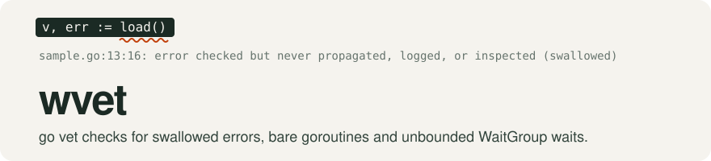
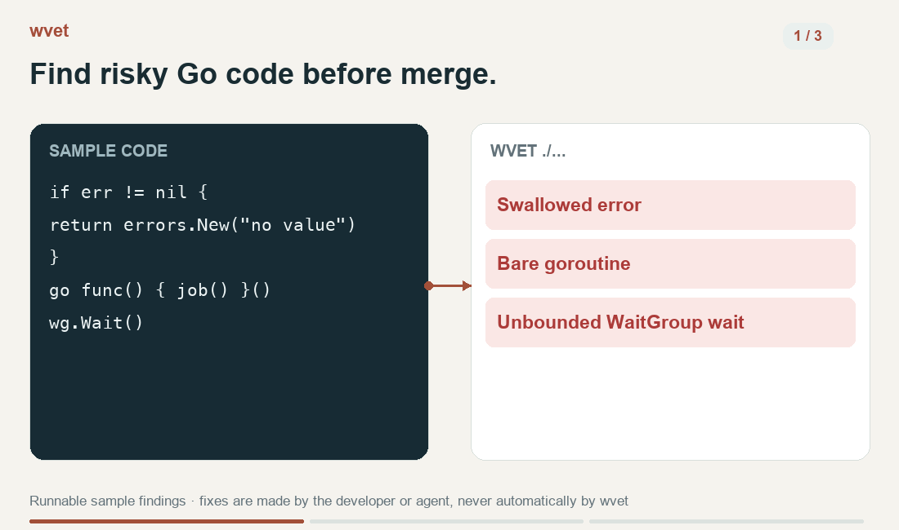
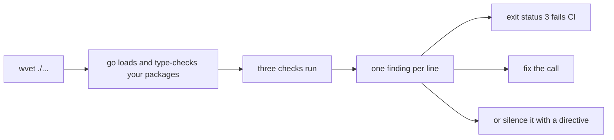

<picture>
  <source media="(prefers-color-scheme: dark)" srcset=".github/assets/banner-dark.svg">
  
</picture>

[](https://github.com/tetriz-ai/wvet/actions/workflows/ci.yml)
[](https://pkg.go.dev/github.com/tetriz-ai/wvet)
[](LICENSE)
[](go.mod)

In a Go service, an error that is checked and then dropped loses its cause, a panic in any
goroutine ends the whole process, and a missed `Done` hangs a WaitGroup wait with no error.
wvet finds the code that allows each of these, so CI can stop it before merge.



Find the risky calls, fix them, and check the corrected example. [Demo details](.github/assets/demo/README.md).

## How it works

<details>
<summary>Implementation flow</summary>



wvet loads your packages through the `go` command and never runs your code. Each finding points
at the call to change. You handle the error, or switch to one of the two helper packages below.
A finding that is right as written gets a directive, a comment such as
`//goroutinecheck:ignore`, that silences it.


</details>

## Quick start

Needs Go 1.26 or newer and git, with `go` and your Go bin directory on `PATH`. CI tests it on
Linux, with archtest and directive-parser tests also on Windows ([details](docs/install.md)).

1. Install wvet.

   ```sh
   go install github.com/tetriz-ai/wvet/cmd/wvet@latest
   ```

2. Clone the repository and move into the sample module of
   [examples/vet-a-module](examples/vet-a-module/), which has one problem of each kind.

   ```sh
   git clone https://github.com/tetriz-ai/wvet
   cd wvet/examples/vet-a-module/testdata/sample
   ```

3. Run wvet. It prints one line per finding and exits with status 3.

   ```sh
   wvet ./...
   ```

   ```text
   /home/you/wvet/examples/vet-a-module/testdata/sample/sample.go:13:16: error checked but never propagated, logged, or inspected (swallowed)
   /home/you/wvet/examples/vet-a-module/testdata/sample/sample.go:25:3: go statement: a panic in this goroutine ends the process; start it with goroutine.Run (github.com/tetriz-ai/wvet/goroutine) or github.com/sourcegraph/conc
   /home/you/wvet/examples/vet-a-module/testdata/sample/sample.go:30:2: sync.WaitGroup.Wait blocks forever if a Done is missed; use waitgroup.SafeWait (github.com/tetriz-ai/wvet/waitgroup) or github.com/sourcegraph/conc
   ```

Your paths start at your clone instead of `/home/you`. To check your own module, run
`wvet ./...` from its root. To pin a version in CI, see [docs/usage.md](docs/usage.md#run-it-in-ci).

## What's in the box

wvet runs three checks.

| Check | Reports |
|---|---|
| [swallowcheck](docs/reference.md#swallowcheck-rules) | An error compared to nil, then never returned, logged or inspected |
| [goroutinecheck](docs/reference.md#goroutinecheck-rules) | Every `go` statement |
| [waitgroupcheck](docs/reference.md#waitgroupcheck-rules) | Every `sync.WaitGroup` `Wait` |

Two helper packages and one test library.

| Use | When you want to |
|---|---|
| [`goroutine.Run`](#fix-a-goroutine-or-wait-finding) | Start a goroutine whose panic reaches your handler, not the process |
| [`waitgroup.SafeWait`, `waitgroup.SafeWaitContext`](#fix-a-goroutine-or-wait-finding) | Wait with a timeout or a context, and get an error back |
| [`archtest`](#write-an-architecture-rule) | Fail a test when your code breaks a structure rule, such as "only commands import flag" |

### What it does not do

- It does not find goroutine leaks.
- It does not report an error that is never checked, which errcheck covers.
- It does not rewrite code, and it refuses `-fix`.

## Common tasks

### Silence one finding

`//<check>:ignore` on the line the check reads silences one finding, so wvet reports nothing on
this file. [examples/suppress-a-finding](examples/suppress-a-finding/) shows where each check
reads one.

```go
// Package sample starts a worker that recovers its own panics.
package sample

// Start runs work in a goroutine.
func Start(work func()) {
	//goroutinecheck:ignore // work recovers its own panics
	go work()
}
```

### Check files behind a build tag

A file behind a build tag is checked only when `GOFLAGS` sets the tag. This run is on the
sample module in [examples/check-tagged-files](examples/check-tagged-files/).

```sh
GOFLAGS=-tags=integration wvet ./...
```

```text
/home/you/wvet/examples/check-tagged-files/testdata/sample/jobs_integration.go:7:2: go statement: a panic in this goroutine ends the process; start it with goroutine.Run (github.com/tetriz-ai/wvet/goroutine) or github.com/sourcegraph/conc
```

### Fix a goroutine or wait finding

After `go get github.com/tetriz-ai/wvet@latest`, which raises your `go.mod` to Go 1.26, this
program runs a job that panics, recovers the panic and bounds the wait.

```go
package main

import (
	"context"
	"fmt"
	"sync"
	"time"

	"github.com/tetriz-ai/wvet/goroutine"
	"github.com/tetriz-ai/wvet/waitgroup"
)

func main() {
	var wg sync.WaitGroup
	wg.Add(1)
	goroutine.Run(context.Background(), func(context.Context) {
		panic("job failed")
	}, func(p *goroutine.PanicError) {
		fmt.Println("recovered:", p.Value)
		// Done goes here, not in a defer: a deferred Done would run before this handler.
		wg.Done()
	})
	if err := waitgroup.SafeWait(&wg, 5*time.Second); err != nil {
		fmt.Println(err)
	}
}
```

```text
recovered: job failed
```

[examples/fix-the-findings](examples/fix-the-findings/) runs three jobs this way, and
[examples/stop-workers-at-a-deadline](examples/stop-workers-at-a-deadline/) stops workers under
a shutdown deadline.

### Write an architecture rule

After `go get github.com/tetriz-ai/wvet@latest`, this test fails when a package outside `cmd/`
imports flag. Save it as a `_test.go` file in your module, and `go test` runs it.

```go
package rules_test

import (
	"go/ast"
	"go/token"
	"strings"
	"testing"

	"github.com/tetriz-ai/wvet/archtest"
)

// Only packages under cmd/ import flag.
func TestFlagOnlyInCommands(t *testing.T) {
	root := archtest.ModuleRoot(t)
	var violations []archtest.Violation
	archtest.WalkGoFiles(t, root, func(path string, _ *token.FileSet, f *ast.File) {
		rel := archtest.RelPath(root, path)
		for _, imp := range f.Imports {
			if imp.Path.Value == `"flag"` && !strings.HasPrefix(rel, "cmd/") {
				violations = append(violations, archtest.Violation{File: rel, Message: "imports flag outside cmd/"})
			}
		}
	})
	archtest.ReportViolations(t, "flag-in-commands", violations, false)
}
```

When `lib/lib.go` imports flag, the test fails and logs these lines after go test's file and
line prefix:

```text
flag-in-commands: 1 violation(s) found:
  lib/lib.go — imports flag outside cmd/
```

[examples/write-an-architecture-rule](examples/write-an-architecture-rule/) adds a file
allowlist and a count ratchet, for rules that land before old violations are fixed.

## Limitations

- swallowcheck misses an error passed to a helper that drops it, so review such helpers.
- goroutinecheck misses goroutines started inside other functions, such as `errgroup.Group.Go`.
- waitgroupcheck misses a `Wait` called through an interface.
- `wvet -json` exits 0 with findings, so gate CI on a run without it.
- swallowcheck also flags cancellation probes (`ctx.Err()`) and expected-error assertions in tests.
- waitgroupcheck flags `Wait` even when every task uses `wg.Go`, which calls Done on return.
- Each check also flags safe code, such as a self-recovering goroutine, so silence it with a directive.

Each check's full misses and false reports are in [docs/limitations.md](docs/limitations.md). Exit
statuses are in [docs/reference.md](docs/reference.md#wvet).

## More

- [docs/reference.md](docs/reference.md): exit codes, flags, each check's rules, directives and the helper APIs.
- [docs/install.md](docs/install.md): `PATH`, release archives, go vet's `-vettool` and your own multichecker.
- [docs/usage.md](docs/usage.md): CI, tagged builds, the helpers and archtest in more depth.
- [examples/](examples/README.md): every example, each run and checked in CI.
- [CONTRIBUTING.md](CONTRIBUTING.md), [SECURITY.md](SECURITY.md), the [MIT License](LICENSE) and [NOTICE](NOTICE).
- [pkg.go.dev](https://pkg.go.dev/github.com/tetriz-ai/wvet): the full API.

wvet follows semantic versioning, and a new finding on unchanged code is a breaking change.
Before v1.0 a minor release may add one, so pin a version in CI. Details are in [docs/reference.md](docs/reference.md#versioning-and-compatibility).

Copyright 2026 Workloom Solutions Private Limited. [CONTRIBUTORS.md](CONTRIBUTORS.md) lists the project's team.
